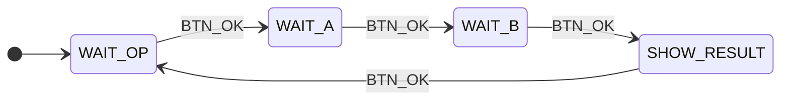

# 4-bit Arithmetic Logic Unit with 8 Operations in VHDL

FPGA implementation of a 4-bit ALU with addition and subtraction in two's complement, logic operations, shifts and status flags (zero, negative, carry out and overflow).

**Equipment:** Xilinx Spartan-3A/3AN Starter Kit (FPGA XC3S700AN-FGG484).

---

## Table of Contents

1. [Overview](#1-overview)
2. [Specification](#2-specification)
3. [State Machine](#3-state-machine)
4. [Architecture](#4-architecture)
5. [Repository structure](#5-repository-structure)
6. [Implementation (Xilinx ISE)](#6-implementation-xilinx-ise)
7. [Operation on the board](#7-operation-on-the-board)
8. [References](#8-references)
9. [Authors](#9-authors)

---

## 1. Overview

This repository contains the VHDL description and pin constraints of a 4-bit Arithmetic Logic Unit (ALU) implemented on an FPGA. These files are intended to be synthesized and implemented in Xilinx ISE 14.7 and programmed on the Xilinx Spartan-3A/3AN Starter Kit (FPGA XC3S700AN-FGG484).

The operation code and both operands are entered through the four slide switches of the board, each value being confirmed with a push button. A finite state machine identifies the current input step and stores the entered values. The 4-bit result and four status flags are then displayed on the board's LEDs.

## 2. Specification

### 2.1 Operations

Eight operations require three bits for the operation code, so only the three least significant switches (`SW(2 downto 0)`) are used in the operation selection step. Operands use all four switches (`SW(3 downto 0)`).

| Code | Operation | Result | Carry (C) | Overflow (V) |
|:---:|---|---|---|---|
| `000` | ADD | A + B | carry out of bit 3 | two's complement overflow |
| `001` | SUB | A − B = A + not B + 1 | 1 = no borrow (A ≥ B, unsigned) | two's complement overflow |
| `010` | AND | A and B | 0 | 0 |
| `011` | OR | A or B | 0 | 0 |
| `100` | XOR | A xor B | 0 | 0 |
| `101` | NOT A | not A | 0 | 0 |
| `110` | SHIFT LEFT | A << 1 | shifted-out bit (A3) | 0 |
| `111` | SHIFT RIGHT | A >> 1 | shifted-out bit (A0) | 0 |

NOT A and both shifts use only operand A; operand B is ignored. In two's complement, 4 bits represent values from −8 to +7.

### 2.2 Status flags

| Flag | Name | Function |
|:---:|---|---|
| Z | Zero | 1 when the result is equal to zero |
| N | Negative | most significant bit of the result, `result(3)`, which is the sign bit in two's complement |
| C | Carry out | carry of the addition; carry of the subtraction (1 = no borrow); shifted-out bit in shifts; 0 in logic operations |
| V | Overflow | result outside the range −8 to +7 in addition and subtraction; 0 in the other operations |

In addition, overflow occurs when two operands of the same sign produce a result of the opposite sign. In subtraction, it occurs when the operands have opposite signs and the sign of the result differs from the sign of A.

### 2.3 Inputs and outputs

| Signal | Board component | Pin | Function |
|---|---|---|---|
| `CLK` | 50 MHz oscillator | E12 | system clock |
| `SW(3:0)` | slide switches SW3..SW0 | T9, U8, U10, V8 | operation code and operands |
| `BTN_OK` | BTN_SOUTH | T15 | confirms each input |
| `BTN_RST` | BTN_WEST | U15 | resets the circuit |
| `LED(7:0)` | LED7..LED0 | W21, Y22, V20, V19, U19, U20, T19, R20 | current step, result and flags |

### 2.4 LED map

| LED | During input | After the operation |
|---|---|---|
| LED7 | step indicator | flag Z |
| LED6 | step indicator | flag N |
| LED5 | step indicator | flag C |
| LED4 | step indicator | flag V |
| LED3..LED0 | value of the switches `SW(3:0)` | result `R(3:0)` |

## 3. State Machine

The input sequence is controlled by a finite state machine with four states: `WAIT_OP`, `WAIT_A`, `WAIT_B` and `SHOW_RESULT`. Each state represents one step of the interaction, and the state changes after each valid press of the confirmation button.



- **WAIT_OP:** waits for the operation code. After confirmation, stores the code and moves to the next state.
- **WAIT_A:** waits for the first operand and stores the value of the four switches.
- **WAIT_B:** waits for the second operand. After confirmation, stores the value and moves to the result.
- **SHOW_RESULT:** displays the result and the flags on the LEDs. A new press returns to the initial state, allowing a new operation.

**Reset (BTN_RST):** returns the machine to `WAIT_OP` regardless of the current state.

## 4. Architecture

The design is described in a single VHDL file, organized in the following blocks:

| Block | Type | Description |
|---|---|---|
| 1a — Synchronizer | sequential | two flip-flops in series per button (`BTN_OK` and `BTN_RST`), preventing metastability |
| 1b — Debounce filter | sequential | accepts a button change only after it remains stable for `DEBOUNCE_MAX` consecutive cycles |
| 1c — Edge detector | combinational | turns the filtered level into a pulse of exactly one clock cycle per press |
| 2 — Control FSM and registers | sequential | controls the input steps and stores `op` (3 bits), `A` (4 bits) and `B` (4 bits) |
| 3 — ALU | combinational | computes the result and the flags; addition and subtraction use a 5-bit adder whose bit 4 is the carry out |
| 4 — LED multiplexer | combinational | selects the LED contents according to the current state |

### 4.1 Contact bounce

The board buttons are mechanical contacts. When pressed or released, they open and close the circuit several times before settling. With a 50 MHz clock (20 ns period), a single press could be seen as tens or hundreds of pulses, and the state machine would advance several steps at once.

To prevent this, `BTN_OK` goes through three stages before reaching the state machine:

1. **Synchronization** with two flip-flops, reducing the chance of metastability.
2. **Stability filter:** a counter accepts a new level only after it remains stable for `DEBOUNCE_MAX` = 1,000,000 cycles, that is, 1,000,000 × 20 ns = 20 ms. Any return to the previous value resets the counter.
3. **Rising edge detector:** generates a single one-cycle pulse per press, regardless of how long the button is held.

`DEBOUNCE_MAX` is a VHDL generic parameter: its default value is used on the board, and it can be reduced in simulation without changing the code programmed on the FPGA.

## 5. Repository structure

```
├── ula.vhd                 # VHDL description of the circuit
├── ula_spartan3an.ucf      # pin constraints for the Spartan-3AN Starter Kit
└── README.md
```

## 6. Implementation (Xilinx ISE)

1. Create a project with the following settings: Family = Spartan3A and Spartan3AN, Device = XC3S700AN, Package = FGG484, Speed = -4, Preferred Language = VHDL.
2. Add `ula.vhd` with association **All** and set it as the top module.
3. Add `ula_spartan3an.ucf` with association **Implementation**.
4. Run **Generate Programming File** and program the FPGA through iMPACT (Boundary Scan).

## 7. Operation on the board

1. BTN_WEST resets the circuit; only LED4 remains lit.
2. The operation code is set on SW2..SW0 and confirmed with BTN_SOUTH.
3. Operand A is set on SW3..SW0 and confirmed with BTN_SOUTH.
4. Operand B is set on SW3..SW0 and confirmed with BTN_SOUTH; the result and flags are then displayed.
5. A further press of BTN_SOUTH starts a new operation.

### 7.1 Test cases

| Code | A | B | LEDs (LED7..LED0) | Remark |
|:---:|:---:|:---:|:---:|---|
| `000` | `0011` (3) | `0010` (2) | `0000 0101` | 3 + 2 = 5 |
| `000` | `0111` (7) | `0001` (1) | `0101 1000` | overflow: 8 exceeds the 4-bit signed range |
| `001` | `0101` (5) | `0101` (5) | `1010 0000` | zero result, no borrow |
| `001` | `0011` (3) | `0101` (5) | `0100 1110` | 3 − 5 = −2 (negative) |

## 8. References

1. ERCEGOVAC, M.; LANG, T.; MORENO, J. H. *Introdução aos Sistemas Digitais*. Porto Alegre: Bookman, 1999.
2. BARBOSA, R. *Tutorial de como utilizar o ISE*. YouTube. Available at: <https://www.youtube.com/watch?v=c1qYBH4PqFc>.
3. XILINX. *Spartan-3A/3AN FPGA Starter Kit Board User Guide*. UG334, Version 1.1, 2008. Available at: <https://docs.amd.com/v/u/en-US/ug334>.

## 9. Authors

| Name | GitHub |
|---|---|
| Bruna Garcia Barrientos Resende | [@BrunaBarr](https://github.com/BrunaBarr) |
| Júlia Teles Braga Sylvestre | [@juliateleseng](https://github.com/juliateleseng) |
